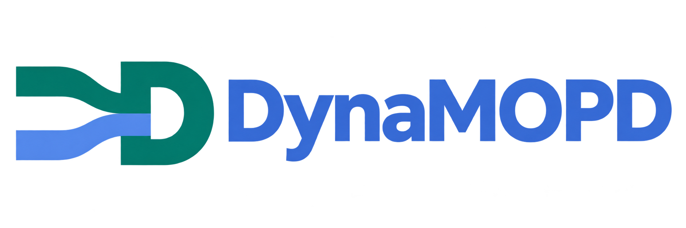
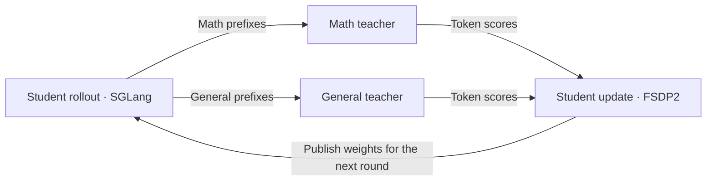

<h1 align="center"></h1>
<p align="center">Synchronous multi-teacher on-policy distillation for language models</p>
<p align="center"><strong>English</strong> · <a href="README_CN.md">Simplified Chinese</a></p>
<p align="center"><a href="#getting-started">Getting started</a> · <a href="#training-recipes">Training recipes</a> · <a href="#documentation">Documentation</a></p>

DynaMOPD lets several frozen teachers train one student on the same pool of GPUs. For example, a math teacher can score a completed answer while the student is still generating a longer answer on another GPU group. All answers in a round come from the same student version. The optimizer takes one step after every eligible answer has been scored and its gradients accumulated.



## Key Features

- **Prefix scoring.** SGLang returns generated tokens in chunks. Each request's assigned teacher can score those tokens as they arrive. A completed, fully scored answer can enter training while other requests continue to generate.
- **GPU sharing.** The scheduler can move unfinished requests at chunk boundaries and reassign freed GPU groups to scoring or PyTorch FSDP2 training. An optional policy can borrow a second group to widen tensor parallelism (TP) for the last request.
- **Distillation objectives.** Choose clipped on-policy K1, sampled reverse KL, importance-sampled forward KL, or teacher top-k cross-entropy. Custom objectives can supply their own routing and per-token loss. [Algorithm interface](algorithms/base.py)
- **Execution and replay.** The same controller can drive local workers, a Ray cluster, or the built-in Python simulator. Simulation and replay need no GPU or external simulator package. Logged samples can replay the prompt and response lengths of a real job. [Extension guide](docs/extensions.md) · [Simulation guide](docs/simulator-cost-search.md)

## Getting Started

### Install

For GPU training, run the following from the repository root in a Linux environment with CUDA and Python 3.10 or later.

```bash
python -m pip install -e '.[gpu]'
```

In an environment that already has the GPU dependencies, use `python -m pip install --no-deps -e .`. Add `packed` for the FlashAttention training recipes, `cluster` for Ray, and `parquet` for Parquet inputs. For example, `python -m pip install -e '.[gpu,packed,cluster,parquet]'` installs all four extras. [Package requirements](pyproject.toml)

### Try simulation on a CPU

The built-in simulator uses only the Python standard library. Install the base package, then run the bundled configuration without downloading model weights:

```bash
python -m pip install -e .
python -m DynaMOPD.run --simulate --config configs/minimal-4gpu.json --out runs/sim-smoke
python -m DynaMOPD.tools.audit runs/sim-smoke
```

Use a fresh output directory for each run. Simulation models scheduling, token lengths and costs; it does not train model weights or measure model quality.

### Run a four-GPU example

Make four GPUs visible to the shell. The example uses eight bundled prompts, a 128-token response limit, and two training rounds. A Qwen2.5-0.5B-Instruct student generates the answers. Qwen2.5-0.5B scores general questions and Qwen2.5-Math-1.5B-Instruct scores math questions. [Example configuration](configs/minimal-4gpu.json) · [Sample data](data/native-smoke.jsonl)

Skip the download loop if the checkpoints are already present. `DYNAMOPD_MODEL_ROOT` overrides the configuration's `model_root`.

```bash
export DYNAMOPD_MODEL_ROOT="${DYNAMOPD_MODEL_ROOT:-$PWD/models}"
for model in Qwen2.5-0.5B-Instruct Qwen2.5-0.5B Qwen2.5-Math-1.5B-Instruct; do
  hf download "Qwen/$model" --local-dir "$DYNAMOPD_MODEL_ROOT/$model"
done

RUN_DIR=runs/first-four bash examples/minimal.sh
python -m DynaMOPD.tools.audit runs/first-four
```

Use a fresh output directory for each run. After a successful run, `metrics.jsonl` contains steps 1 and 2. The two `rollout_barrier` events in `events.jsonl` confirm that every rollout engine received the updated student. Open `runs/first-four/gpu-timeline.html` for the GPU timeline.

## Training Recipes

| Recipe | GPU layout | Workload |
| --- | --- | --- |
| [Four-GPU example](configs/minimal-4gpu.json) | Two 2-GPU FSDP2 groups, four TP1 inference replicas | Two frozen teachers, eight bundled prompts |
| [Default local job](configs/sglang-fsdp2-h20.json) | Four 2-GPU groups, TP2 inference | Two teachers, up to 512 prompt tokens and 1,536 response tokens |
| [Eight-GPU DAPO job](configs/sglang-tp1-fsdp2-8xh20.json) | Four 2-GPU groups, eight TP1 inference replicas | Three teacher routes, batch size 512, up to 8,192 response tokens |
| [Heterogeneous teachers](configs/sglang-tp1-fsdp2-14b-h20.json) | Four 2-GPU groups, TP1 inference | A 7B student with a 14B general teacher and two 7B teacher routes |
| [32-GPU Ray layout](configs/ray-32gpu.json) and [64-GPU Ray layout](configs/ray-64gpu.json) | Four or eight 8-GPU nodes | Run the eight-GPU recipe across nodes with shared model, data and state paths |

The local backend has run two- and three-teacher jobs on 8×H20. The four-GPU example has been checked in CPU simulation. The 32- and 64-GPU layouts have been checked offline. End-to-end validation of the four-GPU example and multi-node throughput measurements are still pending.

For the eight-GPU DAPO recipe, install the `packed` extra and place `Qwen2.5-7B-Instruct`, `Qwen2.5-7B`, and `Qwen2.5-Math-7B` under the model root. Supply JSONL or Parquet records with a `prompt` and a teacher route such as `"teacher": "math"`. Prompts can be strings or chat messages. The student and its routed teacher must assign the same meaning to the token IDs being scored. [Input format](trainer/data.py)

```bash
bash ./launch.sh --config configs/sglang-tp1-fsdp2-8xh20.json \
  --data "${TRAIN_DATA:?set TRAIN_DATA to your training JSONL or Parquet}" \
  --out runs/dapo --state-dir states/dapo
```

In the default local job, `train_budget=4096` gives each rank in a two-GPU group 2,048 input tokens. Its longest permitted training input uses `512 + 1536 − 1 = 2047`. SDPA counts padding within a rank. Packed FlashAttention counts the actual input tokens. [Batch allocation](scheduler/batching.py)

## Documentation

| Task | Guide |
| --- | --- |
| Follow one training round, inspect a checkpoint, or resume a run | [Training and inference](docs/runtime.md) |
| Add an objective, scheduling policy, or executor, or launch a Ray job | [Extending DynaMOPD](docs/extensions.md) |
| Calibrate the simulator and replay a scheduling decision | [Simulator calibration and cost search](docs/simulator-cost-search.md) |
| Audit a run, view a live GPU timeline, or evaluate a held-out set | [Monitoring and evaluation](docs/runtime.md#monitoring-and-evaluation) |

To generate an illustrated guide with links to the implementation, run `python tools/design_walkthrough.py` and open `runs/system-design.html`. Add `--trace runs/first-four/events.jsonl --version 1` to see that round's timeline. A trace from a `cost_search` run also shows the candidate layouts considered by the scheduler.

## Acknowledgments

The training objective draws on work from [verl](https://github.com/verl-project/verl). Earlier simulation work used SimRL; the current virtual-time executor and cost models are implemented within DynaMOPD and require no `srl` package.

## License

DynaMOPD uses the Apache License 2.0. Model weights and datasets are distributed under their respective licenses. [License](LICENSE)
