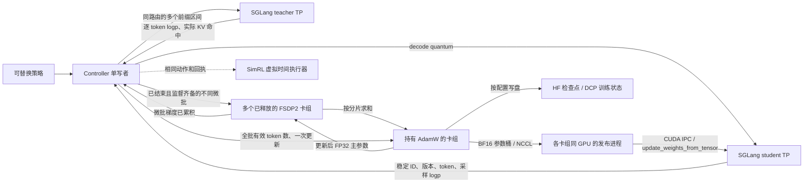

# DynaMOPD

同步多教师 on-policy distillation 框架。默认使用本地四个双卡组，SGLang TP2 生成和前缀评分，PyTorch FSDP2 训练。公共 trainer 也可接 Ray 集群执行器或 SimRL。每轮使用轮初 student，同一个优化器在轮末提交一次。

在八卡节点上可设置 `groups=4`、`group_size=2`、`inference_tp_size=1`。八个单卡 SGLang 引擎独立生成；控制器仍以双卡组交接角色，每个释放的组可用两卡 FSDP2 做前反向。同组的推理副本并行接收请求，同一轨迹按采样 seed 路由到固定副本，每次发布只接收本卡的 CUDA IPC 权重句柄。SimRL 为每个副本分别维护 KV 容量和解码耗时。[推理副本](backends/inference_replicas.py) · [模拟器](backends/simulation.py)

`rollout_sampling_mode=request_seed` 在 decode CUDA 图捕获时使用常规矩阵乘内核，prefill 和教师评分使用 batch-invariant 内核。采样沿用 SGLang 的请求 seed 和绝对位置。`batch_invariant` 额外启用 SGLang 的跨 batch 数值确定性。两种模式启动时均检查续写 token 和评分边界。`calibrate_engine_wake` 可在共享单引擎启动时测量一次唤醒显存。`frozen_teacher_tensor_sync` 使用已暂存的冻结 safetensors，通过本卡 IPC 向兼容的共享推理引擎分桶加载教师。使用 `--phase-barriers` 可在同一配置上测量依次生成、评分和训练的对照。

本地 SGLang/FSDP2 执行器已在 8×H20 上运行过双教师及三教师训练。32/64 卡配置已做离线拓扑核查，多机吞吐仍待实测。

## 安装和模型目录

以下命令在克隆后的仓库根目录执行，使用当前激活的 Python 环境。使用现有 CUDA 运行环境时，可以用 `python -m pip install --no-deps -e .` 安装本包。需要安装可选依赖时，单机 SGLang/FSDP2 使用 `python -m pip install -e '.[gpu]'`，多机加上 `cluster`，使用 FlashAttention 打包训练时加上 `packed`。

示例配置从当前目录的 `models/` 读取本地 Hugging Face checkpoint。模型放在别处时，将 `DYNAMOPD_MODEL_ROOT` 设置为实际目录，或在 JSON 中设置 `model_root`。环境变量优先。以八卡 DAPO 配置为例，该目录应包含 `Qwen2.5-7B-Instruct/`、`Qwen2.5-7B/` 和 `Qwen2.5-Math-7B/`。也可以给各路由填写绝对路径。多机作业要求所有节点能访问这些共享路径。

## 四卡双教师最小训练

在仓库根目录、已安装 `.[gpu]` 的环境中运行。示例用 Qwen2.5-0.5B-Instruct 生成，通用题交给 Qwen2.5-0.5B，数学题交给 Qwen2.5-Math-1.5B-Instruct。使用随包的 8 道题、128 token 回答上限、两轮 K1 更新。四张卡构成两个双卡 FSDP2 组，组内各有两个 SGLang TP1 副本。以下下载只需在缺少本地模型时执行。[四卡配置](configs/minimal-4gpu.json) · [启动脚本](examples/minimal.sh)

```bash
export DYNAMOPD_MODEL_ROOT="${DYNAMOPD_MODEL_ROOT:-$PWD/models}"
for model in Qwen2.5-0.5B-Instruct Qwen2.5-0.5B Qwen2.5-Math-1.5B-Instruct; do
  hf download "Qwen/$model" --local-dir "$DYNAMOPD_MODEL_ROOT/$model"
done
# 在已分配且只可见四张卡的 shell 中运行
RUN_DIR=runs/first-four bash examples/minimal.sh
python -m DynaMOPD.tools.audit runs/first-four
```

每次使用新的输出目录。省略 `RUN_DIR` 时脚本自动生成目录并打印路径。成功完成两轮时，`metrics.jsonl` 的 `step` 依次为 1 和 2，`events.jsonl` 的两条 `rollout_barrier` 分别确认对应版本已发布。单轮内的动作和是否重叠取决于实际进度。当前小模型配方已做 CPU 模拟核查，四卡 GPU 端到端验证待补。

## 运行日志与 GPU 时间线

只在 driver 上写每轮指标。每个作业目录的 `driver.log` 记录启动、提交及异常，`metrics.jsonl` 记录有效训练 token、生成 token、每轮耗时和有效 token/s。真机另记按全轮有效 token 归一化的损失及执行器返回的梯度范数。轮耗时从提交该轮任务前计到新权重的发布屏障，含该轮的检查点写入。模拟器使用虚拟时间。

安装所需 SDK 后，通过 `--track` 启用一个或两个平台。默认仅在本地保存离线记录，使用云端时先按对应 SDK 登录并显式传 `--tracking-mode online`。Python `fit` 配置可使用同名下划线键，例如 `track=["wandb", "swanlab"]`。请通过 SDK 登录或环境变量提供凭证。

```bash
python -m pip install -e '.[wandb,swanlab]'
bash examples/minimal.sh --track wandb swanlab --tracking-mode offline \
  --tracking-project dynamopd --run-name four-gpu
```

打开作业目录中的 **gpu-timeline.html** 可离线查看每个节点的每张物理 GPU。颜色表示 worker 已完成的生成、教师评分、训练、归约、权重发布、转岗和迁移区间。多 TP1 副本的批次回执可以区分有请求和无请求的副本。旧 trace 缺少副本计数时，悬停会注明“卡组回执”。在途动作表示资源已被派发。折线表示整张 GPU 的 NVML 利用率，悬停可查看实际采样时刻和显存 GiB。采样从执行器就绪后开始，至训练循环结束。模拟或缺少读数时只画动作。Ray 在 GPU 所在节点采样，并用启动时的 RPC 往返时间估计到 driver 单调时钟的偏移。

```bash
# 运行期间从本机浏览器查看，默认每 10 秒刷新
python -m DynaMOPD.tools.timeline runs/first-four --serve --port 8765
# 从已有运行重新生成离线 HTML
python -m DynaMOPD.tools.timeline runs/first-four
```

`--gpu-sample-interval 1` 表示每秒采样一次，0 关闭 NVML 采样。`--no-timeline` 可关闭退出时的 HTML 渲染，事件日志仍可供离线重建。[时间线生成器](tools/timeline.py) · [W&B SDK](https://github.com/wandb/wandb) · [SwanLab SDK](https://docs.swanlab.cn/en/api/py-init.html)

## 32 / 64 卡 Ray 集群

多机启动沿用八卡 DAPO 配置，分别覆盖 4×8 卡与 8×8 卡。可以先用 `--check-layout` 离线核对资源，再向 Ray 集群提交一次训练作业。真实多机的吞吐和通信耗时待测。[启动命令、资源配置与扩容范围](docs/extensions.md#放置到-ray-集群)

## 八卡 DAPO 训练

在 8×H20 节点上，从仓库根目录启动八个 SGLang TP1 副本和四个可转岗的双卡 FSDP2 组。下面的配置使用 batch 512 和 8192 回答上限，三个教师按数据中的路由字段共享这些卡。

```bash
CUDA_VISIBLE_DEVICES=0,1,2,3,4,5,6,7 bash ./launch.sh \
  --config configs/sglang-tp1-fsdp2-8xh20.json \
  --data "${TRAIN_DATA:?set TRAIN_DATA to your training JSONL or Parquet}" \
  --out runs/my-tp1-job --state-dir states/my-tp1-job
```

在新输出目录和新状态目录中，用同一条命令追加 `--phase-barriers` 即可运行三个阶段依次执行的对照。[八卡配置](configs/sglang-tp1-fsdp2-8xh20.json)

## 框架与源码入口

从仓库根目录运行 `python tools/design_walkthrough.py` 可生成离线系统设计文档 `runs/system-design.html`。各层的「实现取舍」给出优化的适用条件和源码，包括迁移等待期间继续解码、教师分片复用和跨节点权重发布。加上 `--trace runs/my-job/events.jsonl --version 1` 可查看该轮的并行区间、候选布局，以及每次请求迁移和 TP 交接的耗时分项。[设计文档生成脚本](tools/design_walkthrough.py)

`launch.sh`、`python -m DynaMOPD.run` 和安装后的 `dynamopd` 命令均调用 `DynaMOPD.trainer.fit`。主训练路径在本包内完成。FSDP2 分片和状态装卸工具位于 `utils/fsdp_utils.py`。原生对照实验从原 KDFlow、verl checkout 启动各自的 trainer。[Python 入口](trainer/driver.py) · [FSDP2 工具](utils/fsdp_utils.py) · [来源与许可](licenses/verl.md)

| 组件 | 公共职责与入口 |
|---|---|
| `trainer/` | 校验配置和组件能力，加载或回放样本，由 `fit` 管理恢复、轮次和作业退出。[配置](trainer/config.py) · [数据](trainer/data.py) · [fit](trainer/driver.py) |
| `algorithms/` | 定义教师路由、所需监督和逐 token 损失。内置 sampled reverse KL、单次同步更新的 K1 policy gradient、importance-sampled forward KL 和 teacher top-k 交叉熵。[算法协议](algorithms/base.py) |
| `scheduler/` | 策略读轨迹和卡组进度并提出动作。控制器领取租约、构造 worker 输入、结算监督、决定提交。[观察接口](scheduler/base.py) · [控制器](scheduler/controller.py) |
| `cluster/` | 给全局卡组分配节点和设备，管理 Ray 资源预留与跨节点调用。[拓扑](cluster/topology.py) · [Ray 执行器](cluster/ray.py) |
| `workers/` | 本地和 Ray 共用同一个卡组执行者。`GroupWorker` 在安全点切换角色并管理 SGLang、冻结教师和 FSDP2 rank 的生命周期。[卡组 worker](workers/group.py) · [模型暂存与兼容性](workers/model.py) |
| `backends/` | 将动作交给引擎并返回回执，提供 SGLang、FSDP2 和 SimRL 适配。[执行器协议](backends/base.py) · [SGLang](backends/sglang_engine.py) · [FSDP2](backends/fsdp2.py) · [SimRL](backends/simulation.py) |
| `utils/` | 提供 worker 复用的训练工具，包括 FSDP2 模型分片和状态装卸。[FSDP2 工具](utils/fsdp_utils.py) |
| `tools/` | 对照实验、留出集评估和 trace 审计。[离线工具](tools/) |

算法、策略、后端及集群的配置示例见[扩展指南](docs/extensions.md)。Python 包定义及依赖见[pyproject.toml](pyproject.toml)。

## 在目标节点启动

本地执行器按 `groups × group_size` 使用可见 GPU。下面的命令运行随包提供的小样本。检查点目录须容纳模型初始暂存、推理权重和 FSDP2 训练状态。

```bash
CUDA_VISIBLE_DEVICES=0,1,2,3,4,5,6,7 bash ./launch.sh \
  --config configs/sglang-fsdp2-h20.json \
  --data data/native-smoke.jsonl \
  --out runs/my-first-run --state-dir states/my-first-run
python -m DynaMOPD.tools.audit runs/my-first-run
```

默认运行两轮。启动时读取一次基础 safetensors 到节点本地存储，建立 FSDP2 mesh，每个卡组按配置的 TP 宽度启动 SGLang student 实例。全组就绪即开始 rollout。配置中的 `groups * group_size` 对应可见设备数。相邻设备组成一个组，事件的 `gpu` 字段表示组索引，换岗回执的 `physical_gpus` 给出实际设备。推理模型使用 BF16 和 Triton attention，FSDP2 使用 BF16 前反向、FP32 主参数与梯度归约。初始权重与教师路径、卡数、分块、攒批上限和先验成本见 JSON。启动脚本默认调用当前环境的 `python`。也可显式指定 `PYTHON`、`FA2_DIR` 和 `PY_CACHE`。

输入支持 JSONL 和 Parquet。每行包含 `prompt`（字符串或 chat messages），以及 `teacher` 或 `teacher_routing_key`。也可在配置中设置 `route_field` 和 `routes` 映射现有的 `data_source`。每轮按顺序取 `batch_size` 个请求，读完数据后循环。训练使用 temperature=1、top_p=1 的随机采样。输入和已采样 ID 需要在各路由模型中具有相同的 token 含义。对齐原生 verl 时使用 `train_on_length=true`，自然 EOS 与达到长度上限的回答都保留全部真实响应 token。两类样本均须等到终止并交付完整监督后才可训练。设置 `train_on_length=false` 可单独研究自然 EOS 门槛。

完成版本 2 后，以下命令加载已经提交的模型、FP32 主参数及 AdamW 状态，再训练一轮。使用新的 trace 目录。要跨节点保留版本，可将 `--state-dir` 指向具有足够空间的持久文件系统。

```bash
bash ./launch.sh --resume-version 2 --rounds 1 \
  --out runs/my-continuation --state-dir states/my-first-run
```

## 调用路径与资源所有权



- 原生基线从基线 profile 读取各自的启动命令。其 KDFlow 路径是 `kdflow.cli.train_kd_on_policy → OnPolicyKDTrainer.fit → rollout_manager.rollout → teacher.forward → student.async_run_distill → _sync_rollout_policy`。
- 同一启动器的 verl V0 路径是 `verl.trainer.main_ppo → RayPPOTrainer.fit → async_rollout_manager.generate_sequences`。agent loop 的 `_compute_teacher_logprobs` 在单请求生成后按路由取分数，整批进入 `_update_actor`，FSDP 引擎按微批调用 `forward_step`，随后 `checkpoint_manager.update_weights`。
- SimRL 参考入口为 `SimRL/examples/simulate/mopd/run_elastic.py`。原 `ElasticMopdSimulator._collect_batch` 推进并提交 rollout 实例的事件，KV manager 按块分配和回收，实例用 `step_time` / `decode_segment_time` 推进虚拟时间，完整轨迹入 teacher 队列，排空的组交给弹性调度器。DynaMOPD 的 `backends/simulation.py` 复用其 `UnifiedRoofline`、`ScoringCost`、`KvCacheManager` 和 Request，并增加前缀、迁移、微批和更新动作。 · [共用协议的执行器](backends/simulation.py)
- `scheduler/controller.py` 独占轨迹 journal 和逻辑卡组 lease。策略见 `scheduler/policy.py`，两种执行器共享 `scheduler/protocol.py` 中的请求进度、动作和完成语义。真实角色切换在 `workers/group.py` 执行。每个 FSDP2 rank 通过 `utils/fsdp_utils.py` 分片模型、装卸状态，训练进程位于 `backends/fsdp2.py`。[控制器](scheduler/controller.py) · [策略](scheduler/policy.py) · [真实执行器](backends/native.py) · [FSDP2 worker](backends/fsdp2.py) · [FSDP2 工具](utils/fsdp_utils.py)

## 一轮中的数据和安全点

**前缀和监督。** Stable ID 为 `v{version}/r{index}`。SGLang 每生成一个 quantum 或遇到自然 EOS 即返回不可撤销的 token 及 sampled logprob。引擎内部使用 continuous batching 和 RadixAttention。前缀区间采用从零开始的半开响应区间 `[start,end)`。teacher 以零生成 token 做 batched prefill，输入到目标区间末端，设置 `logprob_start_len=len(prompt)+start-1`。逐条检查 SGLang 返回的前驱 ID、首项空值和所有目标 ID，再交付 logprob。启动时的真引擎边界检查比较整段、缓存续评和清空缓存后重算的结果。

**三种进度。** `Row.tokens` 是确认前缀，`Row.labels` 是已交付的连续监督，`Row.kv` 给出最近可续算的 teacher 副本及位置。Radix 条目可被引擎回收，所以控制器将 KV 位置作为调度提示，通过每次回执中的真实 `cached_tokens` 结算命中。缺失 KV 时由真实引擎重新 prefill。角色切换清空旧缓存。已交付监督存留在 controller。每条轨迹同时至多有一个待交付的评分区间。

**联合分配。** 策略比较各空闲组的评分和训练队列。已结束的回答可以在评分预算内一次取完剩余前缀。已释放的组可以同时训练不同的就绪微批。有积压时，策略按就绪 token 数和已观测的训练速率估计增加一组节省的时间，计入角色切换和轮末梯度归约成本。尚有生成或评分需求时至少留一个服务组。迁移收益由已见前缀和历史完成长度估计。

**迁移与换岗。** 合并先预订两组的下一个 quantum 边界，等待在途请求完成。源交付采样 seed 和绝对 token 位置。这是 SGLang 确定性采样器使用的状态。目标检查 KV 容量，执行真实零生成 prefill 重建 KV，之后源释放所有权和可回收缓存。控制器收到双方回执后改 owner。源和目标均停止接收新 decode，直到协议结束。换岗时排空引擎，执行 flush、release、resume 和权重恢复。节点本地 safetensors 用于恢复已释放的映射，可避免每个休眠副本长期占用一份锁页主机备份。SGLang 回报的新权重版本也会在每个 decode 回执上核对。

**同步更新。** 默认 `on_policy_k1`。在同一轮初权重上先无梯度重算 old logprob，再执行有梯度的 actor 前向。使用当前 actor 和冻结 teacher 对相同响应 token 的 K1 差值形成 detached advantage，执行 verl 的 vanilla PPO 裁剪和 dual clip。每个 rank 对本地有效响应求和，空 rank 也参加组内集合通信。轮末通过 NCCL 将各组相同 FSDP rank 的 FP32 梯度分片加到持有优化器的组。该组按整轮有效响应 token 总数归一化，裁剪一次并执行一次 AdamW。已释放的组可以在优化器组尚在生成时先做前反向。所有 FSDP 副本收到更新后的 FP32 主参数，各 SGLang 引擎确认 BF16 推理版本后，下一轮才开始。[损失实现](algorithms/verl_k1.py) · [跨组归约](backends/replica_sync.py) · [全批更新](backends/fsdp2.py)

SGLang/FSDP2 张量发布配置可用 `max_train_groups` 限制每轮参与训练的组数。默认上限为 `min(groups, max(1, batch_size // (2 * microbatch)))`，实际参与数取决于积压与成本。在同一配置上用 `--max-train-groups 1` 和 `--max-train-groups 4` 可对照单组与四组上限。`replica_bucket_mib` 控制跨组 FP32 通信的临时缓冲区，每个 rank 默认 64 MiB。trace 中的 `reduce_grads` 回执记录各组贡献的 token 数和梯度分片字节数，发布回执中的 `replica_sync_s` 单列主参数同步耗时。

**向 rollout 发布。** 默认 `weight_sync=tensor`。启动时预热发布用的 NCCL 通信组。提交后，训练组按 rank 捕获 BF16 分片，再按桶还原参数并广播到各组相同的 TP rank。唤醒的 SGLang 引擎先恢复权重显存，通过 CUDA IPC 加载张量，最后恢复 KV 和 CUDA Graph。引擎已在运行时直接接收新权重。默认桶目标为 2048 MiB，单个超过该大小的参数独占一个桶。最后一桶刷新缓存、设置版本，全组确认后才能开始下一轮。可用 `weight_sync=disk` 运行磁盘发布路径。[张量发布](backends/weight_sync.py) · [引擎交接](workers/group.py)

**训练状态驻留。** H20 配置使用 `trainer_residency=auto`。训练组结束前反向后，按组内最小空闲显存、实测引擎唤醒占用、最大参数桶和安全余量决定是否将 FP32 主参数和 Adam 状态保留在 GPU。切到尚未测量的新引擎或显存不足时，worker 将状态卸载到 CPU。`trainer_residency=cpu` 固定使用卸载路径。trace 的 `trainer_state_device` 给出交接结果，`reused_trainer_state` 记录下次激活是否复用同版本的 GPU 状态。设置 `share_student_teacher_engine=true` 时，使用相同暂存模型的冻结 teacher 和 student 可复用 SGLang 实例，每次切为 teacher 都显式恢复冻结权重。[FSDP2 worker](backends/fsdp2.py)

**训练微批。** H20 短测默认使用 SDPA。DAPO 对照配置使用 `trainer_attention=flash_attention_2`，按输入长度分配各 rank 的样本，将每个 rank 的微批打包为独立的因果序列，用序列边界和重置的位置编号运行变长注意力。Qwen2 仅投影预测回答 token 的位置，采样 token 的 logprob 使用 verl 的 FlashAttention 交叉熵函数。此路径要求模型支持变长 FlashAttention 和索引形式的 `logits_to_keep`。[微批实现](backends/fsdp2.py) · [logprob 函数](utils/torch_functional.py)

**异构教师与换岗。** 每个卡组保留自己的 student SGLang 进程。兼容性判断使用模型配置及位置编码；同为 7B 的两个模型也必须各自加载冻结权重。`inference_layout=single` 允许配置兼容的模型共享引擎，`replicas` 默认仅对相同模型路径复用引擎。其他教师使用自己的 SGLang scheduler，使用配置中的 TP 宽度、attention 后端和 BF16 精度，按原有路由返回 sampled logprob 或 top-k。逐 token 目标要求被评分的 token ID 在双方词表中的含义一致。[卡组交接](workers/group.py) · [逐 token 监督](backends/sglang_engine.py)

卡组排空或完成迁移后，student 释放权重、KV 和图占用。CPU 管理进程随后启动教师 GPU rank，从该教师的节点本地 checkpoint 加载，直接向 scheduler 提交 token ID 批次。同一路由可以连续评分并使用 Radix KV。该路由本轮轨迹全部终止且监督结清后，空闲的教师组立即转入 `standby`，可以与其余卡的训练并行释放。换出教师时，各 rank 及其辅助子进程均须退出并被回收，之后才能启用下一个角色。等待分配的管理进程没有可见 GPU。切回 student 使用原进程并恢复对应版本。每次异构教师重新上卡仍须建立 CUDA/TP 状态并装入权重。[教师 rank 管理](backends/teacher_pool.py) · [SGLang 评分与释放回执](backends/teacher_rank.py)

`preflight_heterogeneous_teachers=true` 在第一轮前加载、检查并释放教师，用节点文件缓存和内核编译缓存为后续激活做准备。`single` 布局检查所有异构路由；`replicas` 布局按 `warm_teachers` 与 `teachers_per_group` 轮转选择预热路由。设为 `false` 时，首次分配该模型才执行检查。`wall_s` 包含预热，训练步耗时统计从轮初开始。调度器用实测的路由激活时间和已经公布的 token 积压评估转岗。换岗 trace 的 `teacher_rank_load_s` 是该组启动教师的实际用时，`teacher_rank_timings` 区分每个 rank 的导入准备与 scheduler 初始化，`teacher_rank_release_s` 包括等待退出。可以对照 `released_teacher_pids`、`active_teacher_gpu_pids`、`inference_pids` 和各卡的空闲显存。`release_nvml_checked` 表示是否另外核对了 NVML 中的进程列表。SimRL 可以通过 `sim_teacher_activation_s` 分别指定各个异构路由的激活成本。[标定工具](tools/calibrate.py) · [端到端计时](tools/compare_results.py)

**恢复粒度。** 随附 H20 配置设为 `checkpoint_interval=0`，只在末轮保存可恢复的 HF 与 DCP 检查点。正整数 K 表示每 K 轮和末轮保存。没有保存完整优化器状态的中间轮由原训练组继续保管主参数和 AdamW 状态。配置 `checkpoint_contents=["hf_model"]` 只导出模型，适用于对齐 verl 的评测，继续训练所需的优化器状态要通过包含 `training` 的检查点恢复。trace 用 `hf_checkpoint` 标记 HF 检查点，`durable` 标记可恢复训练状态，`rollout_barrier` 记录所有引擎已加载新版本。

## 策略实验与验证

模拟器需要当前 Python 环境可导入 SimRL 的 `srl` 包。也可将自己的 SimRL checkout 加入 `PYTHONPATH`。

```bash
python -m DynaMOPD.run --simulate --policy natural --out runs/my-sim-natural
python -m DynaMOPD.run --simulate --policy merge --out runs/my-sim-merge
```

两次模拟使用相同 seed、提示长度和目标长度。也可传 `--replay runs/my-first-run` 让模拟执行器使用真机采样长度，并指定与真机一致的配置。目标长度只存在于模拟执行器。默认成本为初始估计。真实 trace 的 `dispatch` 是控制器发令，`complete.start/end` 是执行器收到命令到引擎回执的单调时钟区间。它包括 RPC 和同步开销。迁移回执另记 export、install、release 的时间戳、采样状态字节数与 KV 重算量。GPU 利用率和 kernel 级并发需单独使用 profiler 测量。

多系统对照的 HTML 回放统一使用每个系统一张时间线。生成、长尾等待、评分、换岗、训练和发布共用卡行及时间轴，轮询重建的区间在图中标注。[时间线生成器](tools/scenario_timeline.py)

已有论文数据包时，可在仓库父目录运行 `python -m DynaMOPD.tools.paper_report /path/to/DynaMOPD-paper-data.zip`。生成的离线 HTML 首页按场景显示加速比，点选场景可在同一秒轴上查看各系统的逐卡活动。[报告生成器](tools/paper_report.py)

H20 配置在 CLI 使用 `--simulate` 时默认运行 `cost_search`。每个决策将自然排空和可行的迁移、评分组、训练微批布局按预计剩余轮时比较。已有五组真机回执的留出误差、KV 样本覆盖和两种负载的同 token 回放结果见[模拟器标定与动作搜索](docs/simulator-cost-search.md)。

真实 SGLang/FSDP2 作业的首轮也执行训练。调度器从空成本表开始，按空闲卡组数分配已有的前缀和就绪样本。每个批次在派发时认领样本。首轮结束后，`cost_calibration` 记录本作业测得的评分、训练、换岗、归约与权重发布成本。下一轮使用这些观测搜索动作组合，每轮结束后继续校准。同一配置文件里用于 SimRL 重放的历史成本只描述模拟硬件。

启用跨节点分片副本和张量发布时，训练 rank 先同步更新后的主参数；每个节点再从本地的主参数分片构造可训练权重的 BF16 rollout 桶。含冻结参数或缓冲区的桶由权威副本分发。`rollout_lane_payload_bytes` 统计发布阶段每条跨副本通道分发的权重字节数；梯度归约和主参数同步分别计量。

要按本机实测成本重放，可用 `python -m DynaMOPD.tools.calibrate runs/my-first-run --version 0 --output runs/h20-costs.json`。将生成的配置作为模拟命令的 `--config`。以其他轮次检验预测时，标定输入应仅含已经完成的历史轮次。

### 用空闲卡加速最后一条 rollout

`elastic_tp` 在 `merge` 策略上增加一项双卡组租约动作。当全轮仅剩一条正在生成的轨迹时，controller 可以在 token 分块边界借用同节点的空闲卡组。例如两个 TP2 组共同执行这条轨迹的 TP4 解码，其他组继续评分或训练。模拟 KV 重分片时允许借用 rollout 和 teacher 组。真实 TP4 执行器也可以在微批完成后暂借训练组，保留其未提交梯度。每个宽 TP 分块都正常交付前缀。轨迹终止或下游积压使提前归还有利时，两个组恢复原来的布局。[调度实现](scheduler/tail_tp.py) · [模拟执行](backends/simulation.py)

本地 SGLang 执行器使用已建立通信组的四卡引擎。每个候选卡组对在开训前加载、校验并休眠。权重使用 SGLang 的主机备份，休眠时释放由 memory saver 管理的权重、KV 池和解码图缓冲区。进程、已捕获的计算图和 CUDA 上下文在下次唤醒时复用。轮末让窄引擎和配对的宽引擎共同消费同一组 FSDP2 发布桶。每个接收进程独立导出 CUDA IPC 引用，共享同一块源张量。发布方等待全部回执后回收缓冲区。宽引擎只在后面还有训练轮次时参与权重发布。

运行时，控制器比较预计节省的解码时间与唤醒、前缀重算、归还和推迟评分或训练的时间。取得两个组的独占租约后，worker 再次查询空闲显存，恢复本轮 student，使用相同 seed、绝对 token 位置和已提交的前缀恢复请求，核对最后一个已采样 token 的 logprob。其他组继续原来的工作。当前执行路径在目标上重算 KV，训练 trace 的 `tp_expand`、带 `peer` 的 `decode` 和 `tp_shrink` 分别给出接卡、宽解码和归还时间。[原生执行器](backends/elastic_rollout.py) · [成本配置](configs/h20-rollout-tp1-tp4.json)

以八卡 DAPO 配置启用宽 TP 时，在训练命令中加入 `--policy elastic_tp --rollout-tp-profile configs/h20-rollout-tp1-tp4.json`，并使用新的输出目录。要复现 16K 回答上限，可复制这份配置并将 `max_new_tokens` 改为 16384，根据硬件设置 KV 容量。


比较策略时给两次运行提供相同的负载、GPU 布局和 TP 成本文件。下面两条命令使用同一个确定性生成的负载。要观察指定长尾，可在两条命令中同时加上相同的 `--replay` 和与采样对应的 `--config`。

```bash
profile=configs/sim-tail-tp2-tp4.json
python -m DynaMOPD.run --simulate --policy merge --sim-tp-profile "$profile" --out runs/merge-fixed-tp
python -m DynaMOPD.run --simulate --policy elastic_tp --sim-tp-profile "$profile" --out runs/merge-elastic-tp
```

**TP2→TP4 的模拟 KV 重分片模型。** 在每个候选卡组上，用基础和目标 TP 各自的 SimRL roofline 预测同一条尾部剩余解码时间。两者之差需要覆盖扩容、归还、借走该组导致的评分训练排队，以及丢弃该组 teacher KV 的预计重算时间。卡组对第一次使用时计入通信组建立时间。对同版本的 rollout 副本，模型假设可直接取本地权重分片视图；借用 teacher 组还要计入恢复 student 和换回 teacher 的时间。安装宽布局按上下文 token 数搬运一半的模型逻辑 KV 字节；原组保留扩容时的前缀。提前缩容只回传宽 TP 期间新增的 KV 分片，EOS 后只付布局恢复开销。两个卡组均预留逻辑 KV 块，配置的临时显存余量须能容纳重排。

**成本与 trace。** 随附 TP2/TP4 系数、带宽和交接耗时用于敏感性分析。真机校准应按相同模型、拓扑和稀疏 batch 获取每个 TP 的逐步解码时延（含 collective），并分别测量首次和后续布局切换、KV 有效传输带宽。配置中可用 `group_pairs` 限定允许合并的同节点组，例如 `[[0,1],[2,3]]`。示例采用 28 个 query heads、4 个 KV heads 的 Qwen2.5-7B；这个重分片模型限于宽度翻倍且两类 head 数都可被目标 TP 整除的布局。观察 `tp_expand`、带 `peer` 和 `tp_width` 的 `decode`、`tp_shrink` 回执。`predicted_gain_s` 是决策时的预测；比较整轮收益请使用相同 token 数下的 `round_s`，它包含最终权重发布。审计另汇总 `tp_resize_s`、`wide_decode_s` 和 `tp_kv_transfer_bytes`。[示例参数](configs/sim-tail-tp2-tp4.json) · [成本模型](backends/sim_tp.py)

**实现依据。** PAT 用预计剩余解码收益与重配置成本选择 TP 宽度。DynaMOPD 在这个判断中加入了多教师评分与训练积压。Flying Serving 将通信组的创建移到切换之前，ReMP 将拓扑的生命周期与请求状态解耦。真机 SGLang 执行器预建引擎，在同版本的宽引擎重算已提交前缀；SimRL 还可用独立配置研究直接搬运 KV 分片的收益。[PAT](https://arxiv.org/abs/2605.23945) · [Flying Serving](https://arxiv.org/abs/2602.22593) · [ReMP](https://arxiv.org/abs/2606.18741)

## 教师加载、KV 和宽 TP 的执行开销

14B 示例启用 `teacher_rank_images`。首次在预检中用原 HF 权重启动稠密 BF16 Qwen2 教师，一个 TP 副本将各 rank 的已装载参数写入 `state_dir/teacher_rank_images/`。后续租约从 SGLang 原生 `sharded_state` 文件加载，仍使用原模型配置和 tokenizer。每组首次使用该格式时，会以固定 token 前缀与 HF 基准逐位置比对 logprob。镜像键包含源模型暂存路径、TP、设备类型及引擎包版本。每个镜像需要约一份教师权重的额外磁盘空间，可在同一状态目录复用。设 `teacher_rank_images=false` 可只用原 HF 加载。租约释放仍退出教师 GPU 进程。[14B 配置](configs/sglang-tp1-fsdp2-14b-h20.json) · [冻结教师镜像](backends/teacher_image.py) · [SGLang 对应版本的加载器](https://github.com/sgl-project/sglang/blob/v0.5.10.post1/python/sglang/srt/model_loader/loader.py)

评分超过组内 `teacher_kv_tokens` 预算时，worker 按独立推理副本选择要清空的 KV。只有实际清空的副本撤回相应的前缀位置，监督仍保存在轨迹日志中。真机与 SimRL 的评分回执均包含 `flushed_score_lanes` 和 `evicted`。[KV 预算实现](backends/score_cache.py)

本地宽 TP 启用时，`overlap_wide_startup` 默认允许 FSDP rank 提前启动并导入 PyTorch；宽引擎休眠且显存测量完成后才开放 FSDP 的 CUDA 初始化。`parallel_wide_publication` 默认将同一桶的两个独立 CUDA IPC 句柄并发交给窄、宽引擎，两端均确认后，该组才能复用桶。两项都可分别设为 `false`。宽引擎为当前支持的单请求 decode 捕获 batch 1 CUDA Graph。[本地启动](backends/native.py) · [权重发布](workers/group.py)

比较相同负载时，`teacher_preflight` 单列首次建镜像的 `image_build_s`；真实切换回执记录 `teacher_load_format`、`teacher_rank_load_s` 和 `teacher_alignment_s`。`wide_mesh_ready` 列出宽引擎 ready、休眠以及分片进程预备耗时。`wide_publish_s` 是卡组参与宽发布的时间，`wide_publish_exposed_s` 是其中超过同组窄发布完成时刻的部分。多个组的时间可以重叠，评价整轮使用发布屏障与端到端计时。首次准备和稳态需要分别比较。

## 原生基线和质量评估

对照工具使用显式指定的 `--profile-root` 或 `MOPD_PROFILE_ROOT`。该目录的 `data/` 提供 `dapo.jsonl`、`dapo.parquet`、`pilot.jsonl` 和路由到模型目录的 `teachers.json`；`repos/` 提供所选基线的 KDFlow 或 verl checkout。可用 `--command-file` 指定含有 `command` 参数数组的原生命令 JSON，默认读取 profile 内的 `results/{system}_dapo_1/run.json`。

同配置对照默认使用 DynaMOPD 和 KDFlow。八卡时，两者都以 8 个 TP1 引擎生成，教师也使用 TP1，评分容量为 8 个单卡副本；训练使用分片宽度为 2 的 FSDP2 和最多 4 个训练副本。DynaMOPD 在一轮内实际启用几个副本由调度器决定。用 `--tp-size` 可以一起修改学生和所有教师的 TP，用 `--group-size` 可以一起修改训练分片宽度。两套启动命令从同一个 `config.json` 读取每卡微批、token 预算、推理上下文与 KV 容量、prefill 和并发上限、显存比例、模型、采样温度、种子、全局 batch 和长度上限。DynaMOPD 和 KDFlow 都使用 SGLang 原生 batch-invariant 模式，并按全局种子、轮次和题目位置生成请求种子。默认用同一批 DAPO 题训练六步，batch 512，回答上限 8192。教师监督传递、引擎内核、微批打包和权重发布仍采用各自系统的实现。

启动器检查最终命令，保存布局、配置和数据摘要。跨系统汇总再次核对这些记录。原生 verl 在本仓库入口中为 actor 和教师分别预留 GPU。同一节点预算下，它的可用 rollout 副本数与全卡生成方案不同。可以用新目录和 `--systems verl` 单独准备、运行和查看该参考。已有实验保留原始数据，单系统汇总可用 `--training-only --systems 系统名`。早先三系统表格只能用于查看各自配置的绝对耗时。[基准启动器](tools/benchmark.py) · [布局核对](tools/benchmark_layout.py)

```bash
PY=${PYTHON:-python}
export MOPD_PROFILE_ROOT="${MOPD_PROFILE_ROOT:?set your benchmark profile directory}"
OUT=runs/my-dapo
STATE=states/my-dapo
$PY -m DynaMOPD.tools.benchmark prepare --out "$OUT"
BACKUP=.local/dynamopd-tms
test -f "$BACKUP/SOURCE_SHA256" || $PY -m DynaMOPD.tools.build_pageable_backup --out "$BACKUP"
$PY -m DynaMOPD.tools.benchmark dynamopd --out "$OUT" --state-dir "$STATE"
$PY -m DynaMOPD.tools.benchmark kdflow --out "$OUT" --state-dir "$STATE" --pageable-backup "$BACKUP"
$PY -m DynaMOPD.tools.quality --out "$OUT" --state-dir "$STATE"
$PY -m DynaMOPD.tools.prefix_quality --out "$OUT" --state-dir "$STATE"
$PY -m DynaMOPD.tools.compare_results "$OUT"
```

评估脚本用相同 tokenizer 和 greedy 解码口径测量初始权重和三个最终 checkpoint，逐题保存预测和原始回答。`prefix_quality` 使用初始模型答案的同一组固定前缀，每题取开头、约三分之一、三分之二及回答末 token 前的位置，计算每个 student 对对应冻结 teacher 的全词表 KL，以 nat 为单位。32 道留出题可用于检查短训后的质量变化。形成收敛结论需要更长的训练和更大的验证集。

若原生 KDFlow 在 SGLang 休眠时遇到主机锁页分配失败，可选择以下备份实现。上述 `--pageable-backup` 为该作业单独加载 torch-memory-saver 0.0.9，从 SHA256 固定的同版源包构建，只将 weight backup 主机缓冲区的分配和释放改为 `malloc/free`。同步 D2H/H2D、显存解除映射、训练器、权重同步、采样和损失均由原生代码执行。可用 `--archive` 指定离线源包。主机锁页正常时可以省略这一构建和运行参数。[备份构建工具](tools/build_pageable_backup.py)

## 许可证

DynaMOPD 自有代码采用 Apache License 2.0。来自 verl 的代码保留上游归属和声明。模型权重和数据集分别按其来源条款使用。[项目许可证](LICENSE) · [第三方声明](NOTICE) · [verl 来源](licenses/verl.md)
