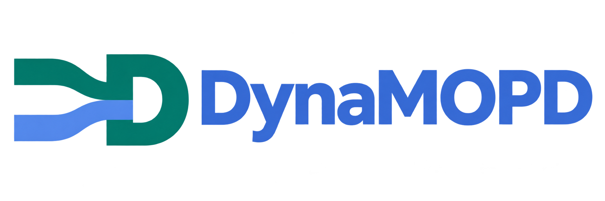
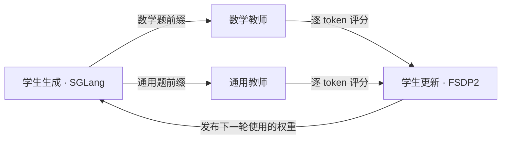

<h1 align="center"></h1>
<p align="center">面向语言模型的同步多教师在线策略蒸馏框架</p>
<p align="center"><a href="README.md">English</a> · <strong>简体中文</strong></p>
<p align="center"><a href="#快速开始">快速开始</a> · <a href="#训练示例">训练示例</a> · <a href="#技术文档">技术文档</a></p>

DynaMOPD 让多个冻结的教师模型与一个学生模型共享同一批 GPU。例如，学生还在一组 GPU 上生成较长的回答时，数学教师就可以在另一组 GPU 上给已经完成的回答评分。每轮的所有回答都来自同一版本的学生模型。待所有符合训练条件的回答获得监督、梯度累积完毕后，优化器只更新一次。



## 核心功能

- **前缀评分。** SGLang 分块返回生成的 token，每条请求对应的教师可以随到随评。一个回答生成完毕且监督齐全后，即可进入训练，其他请求继续生成。
- **GPU 共享。** 调度器可以在生成分块的边界迁移未完成的请求，把腾出的卡组用于评分或 PyTorch FSDP2 训练。可选策略还可以为最后一条请求借用第二个卡组，提高张量并行度（TP）。
- **蒸馏目标。** 内置带裁剪的 on-policy K1、采样反向 KL、重要性采样前向 KL，以及教师 top-k 交叉熵。自定义目标可定义教师路由和逐 token 损失。[算法接口](algorithms/base.py)
- **执行与回放。** 同一控制器可以驱动本地 worker、Ray 集群或内置 Python 模拟器。模拟与回放不需要 GPU 或外部模拟器包。使用真实作业记录的样本，可以在模拟中重放每条请求的提示和回答长度。[扩展指南](docs/extensions.md) · [模拟器指南](docs/simulator-cost-search.md)

## 快速开始

### 安装

进行 GPU 训练时，请在配有 CUDA 和 Python 3.10 或更高版本的 Linux 环境中，从仓库根目录执行以下命令。

```bash
python -m pip install -e '.[gpu]'
```

如果环境中已有 GPU 依赖，可执行 `python -m pip install --no-deps -e .`。使用 FlashAttention 打包训练时加上 `packed`，使用 Ray 时加上 `cluster`，读取 Parquet 时加上 `parquet`。例如，`python -m pip install -e '.[gpu,packed,cluster,parquet]'` 可安装这四组依赖。[依赖声明](pyproject.toml)

### 在 CPU 上试运行模拟

内置模拟器仅使用 Python 标准库。安装基础包后即可运行随包配置，无须下载模型权重：

```bash
python -m pip install -e .
python -m DynaMOPD.run --simulate --config configs/minimal-4gpu.json --out runs/sim-smoke
python -m DynaMOPD.tools.audit runs/sim-smoke
```

每次运行使用新的输出目录。模拟用于分析调度、token 长度和成本，不训练模型权重，也不衡量模型质量。

### 运行四卡示例

让当前 shell 能看到四张 GPU。示例使用随包提供的 8 道题，回答上限为 128 个 token，共训练两轮。学生 Qwen2.5-0.5B-Instruct 生成回答，Qwen2.5-0.5B 为通用题评分，Qwen2.5-Math-1.5B-Instruct 为数学题评分。[示例配置](configs/minimal-4gpu.json) · [示例数据](data/native-smoke.jsonl)

如果本地已有这三个检查点，可以跳过下载循环。`DYNAMOPD_MODEL_ROOT` 优先于配置中的 `model_root`。

```bash
export DYNAMOPD_MODEL_ROOT="${DYNAMOPD_MODEL_ROOT:-$PWD/models}"
for model in Qwen2.5-0.5B-Instruct Qwen2.5-0.5B Qwen2.5-Math-1.5B-Instruct; do
  hf download "Qwen/$model" --local-dir "$DYNAMOPD_MODEL_ROOT/$model"
done

RUN_DIR=runs/first-four bash examples/minimal.sh
python -m DynaMOPD.tools.audit runs/first-four
```

每次运行使用新的输出目录。成功后，`metrics.jsonl` 会记录第 1、2 步。`events.jsonl` 中两条 `rollout_barrier` 事件表示每轮更新后的学生权重已送达所有生成引擎。打开 `runs/first-four/gpu-timeline.html` 可查看 GPU 时间线。

## 训练示例

| 配置 | GPU 布局 | 训练任务 |
| --- | --- | --- |
| [四卡示例](configs/minimal-4gpu.json) | 两个双卡 FSDP2 组，四个 TP1 推理副本 | 两个冻结教师，8 道随包示例题 |
| [默认本地训练](configs/sglang-fsdp2-h20.json) | 四个双卡组，TP2 推理 | 两个教师，提示上限 512 token，回答上限 1,536 token |
| [八卡 DAPO 训练](configs/sglang-tp1-fsdp2-8xh20.json) | 四个双卡组，八个 TP1 推理副本 | 三条教师路由，批大小 512，回答上限 8,192 token |
| [异构教师](configs/sglang-tp1-fsdp2-14b-h20.json) | 四个双卡组，TP1 推理 | 7B 学生，由 14B 通用教师和两条 7B 教师路由提供监督 |
| [32 卡 Ray 配置](configs/ray-32gpu.json)和 [64 卡 Ray 配置](configs/ray-64gpu.json) | 四台或八台八卡节点 | 将八卡训练配置扩展到多机，节点间共享模型、数据和状态路径 |

本地后端已在 8×H20 上运行过双教师和三教师作业。四卡示例已通过 CPU 模拟检查，32 卡和 64 卡配置已通过离线拓扑检查。四卡示例的端到端 GPU 验证和多机吞吐实测仍待完成。

运行八卡 DAPO 配置前，先安装 `packed` 依赖组，并将 `Qwen2.5-7B-Instruct`、`Qwen2.5-7B` 和 `Qwen2.5-Math-7B` 放在模型根目录下。每条 JSONL 或 Parquet 训练记录需要包含 `prompt` 和教师路由，例如 `"teacher": "math"`。提示可以是字符串或聊天消息。学生和对应教师对参与评分的 token ID 须有相同解释。[输入格式](trainer/data.py)

```bash
bash ./launch.sh --config configs/sglang-tp1-fsdp2-8xh20.json \
  --data "${TRAIN_DATA:?set TRAIN_DATA to your training JSONL or Parquet}" \
  --out runs/dapo --state-dir states/dapo
```

默认本地配置中，`train_budget=4096` 让双卡组中的每个 rank 有 2,048 个训练输入 token 的预算。该配置允许的最长训练输入为 `512 + 1536 − 1 = 2047`。SDPA 计入同一 rank 内的填充，变长 FlashAttention 按实际输入 token 计费。[微批分配](scheduler/batching.py)

## 技术文档

| 想了解什么 | 英文指南 |
| --- | --- |
| 跟踪一轮训练、检查或恢复训练状态 | [训练与推理](docs/runtime.md) |
| 添加蒸馏目标、调度策略或执行器，或启动 Ray 作业 | [扩展 DynaMOPD](docs/extensions.md) |
| 标定模拟器、回放调度决策 | [模拟器标定与成本搜索](docs/simulator-cost-search.md) |
| 审计作业、查看实时 GPU 时间线或评估留出集 | [监控与评估](docs/runtime.md#monitoring-and-evaluation) |

运行 `python tools/design_walkthrough.py` 后，打开 `runs/system-design.html` 可查看带源码链接的系统设计图解。追加 `--trace runs/first-four/events.jsonl --version 1` 可查看该轮的执行时间线。如果使用 `cost_search` 作业的日志，还能看到调度器考虑过的候选布局。

## 致谢

训练目标的设计参考了 [verl](https://github.com/verl-project/verl)。早期模拟工作使用过 SimRL；当前虚拟时间执行器与成本模型均由 DynaMOPD 内置实现，无须安装 `srl` 包。

## 许可证

DynaMOPD 采用 Apache License 2.0。模型权重和数据集遵循各自的许可条款。[许可证](LICENSE)
