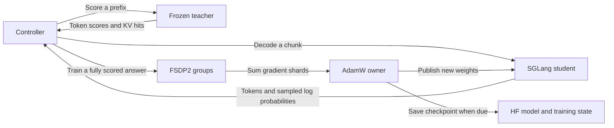

# Training and inference

All three entry points (`dynamopd`, `python -m DynaMOPD.run` and `launch.sh`) call `DynaMOPD.trainer.fit`. The driver owns the training round. A scheduling policy proposes actions, the controller assigns GPU groups, and local workers or Ray actors execute those actions. The built-in simulator implements the same action and completion protocol on a virtual clock. [Driver](../trainer/driver.py) · [Controller](../scheduler/controller.py) · [Protocol](../scheduler/protocol.py) · [GPU group worker](../workers/group.py)

## Run and resume the default job

The default configuration uses four adjacent pairs of GPUs. Each pair hosts one SGLang TP2 student engine and can become a two-rank FSDP2 training group. Install the `gpu` extra and place `Qwen2.5-7B-Instruct`, `Qwen2.5-Math-7B` and `Qwen2.5-7B` under `models/` or `DYNAMOPD_MODEL_ROOT`. A job can also use absolute checkpoint paths. On a cluster, all workers must be able to read the configured paths. Allocate storage for the staged model weights, inference exports and distributed training checkpoints. [Configuration](../configs/sglang-fsdp2-h20.json)

```bash
CUDA_VISIBLE_DEVICES=0,1,2,3,4,5,6,7 bash ./launch.sh \
  --config configs/sglang-fsdp2-h20.json --data data/native-smoke.jsonl \
  --out runs/my-first-run --state-dir states/my-first-run
python -m DynaMOPD.tools.audit runs/my-first-run
```

The launcher uses the current `python` by default. It also accepts `PYTHON`, `FA2_DIR` and `PY_CACHE`. At startup the workers stage the base safetensors, build the FSDP2 meshes and start the configured inference replicas. Training uses BF16 forward and backward computation with FP32 master parameters and gradient reduction. In the trace, `gpu` denotes a logical group index. The handoff receipt lists the physical devices in `physical_gpus`. [Launcher](../launch.sh) · [Device placement](../cluster/topology.py) · [Sharding](../backends/sharding.py)

For each round the trainer takes the next `batch_size` records in order, cycling through the dataset as needed. A record can carry `teacher` or `teacher_routing_key`, or the configuration can map a dataset field through `route_field` and `routes`. With the default `train_on_length=true` for K1, both natural EOS and length-limited answers contribute their actual response tokens. Setting it to `false` limits training to answers that finish naturally. [Input handling](../trainer/data.py) · [Objectives and routing](../algorithms/base.py)

The default job saves a resumable checkpoint at the end of round two. Continue for one more round with the same state directory and a fresh log directory.

```bash
bash ./launch.sh --resume-version 2 --rounds 1 \
  --out runs/my-continuation --state-dir states/my-first-run
```

A `checkpoint_interval` of zero saves only the final round. A positive interval saves every K rounds and the final round. The `training` checkpoint contains FP32 master parameters and AdamW state. A configuration with `checkpoint_contents=["hf_model"]` only exports the model for inference or evaluation. The trace records `hf_checkpoint` for a model export, `durable` for resumable state, and `rollout_barrier` when all rollout engines acknowledge the new version. [Checkpoint writer](../backends/fsdp2.py) · [Resume checks](../trainer/driver.py)

## What happens in a round



**Generation and scoring.** Each request has a stable ID of the form `v{version}/r{index}`. The student returns an immutable prefix at the end of a decode chunk or at EOS. A teacher scores a zero-based, half-open response interval `[start, end)` by prefilling through its final token with `logprob_start_len=len(prompt)+start-1` and zero new tokens. The worker checks the predecessor ID, the leading null score and the target IDs before accepting the returned log probabilities. Startup probes compare full, cached and recomputed scores. [SGLang worker](../backends/sglang_engine.py) · [Alignment checks](../backends/checks.py)

**Prefix state.** `Row.tokens` holds the committed prefix, `Row.labels` the contiguous teacher scores, and `Row.kv` maps each GPU group retaining the teacher prefix to its last known cached position. Each trajectory can have one outstanding scoring interval. Cache evictions can invalidate a suggested location, so the scheduler uses `cached_tokens` in the receipt to account for actual hits. The controller retains delivered scores when a worker changes roles or clears its cache. If a scoring batch exceeds `teacher_kv_tokens`, only the affected replicas lose their prefix locations. Both executors report `flushed_score_lanes` and `evicted`. [Trajectory state](../scheduler/protocol.py) · [Cache accounting](../backends/score_cache.py)

**Scheduling and migration.** The scheduler weighs the scoring and training queues, the observed service rates, the cost of changing roles and the final reduction. It retains a service group while generation or scoring still needs it. To move a request, the controller reserves both groups at chunk boundaries. The destination checks capacity and accepts the committed prefix, seed and absolute sampling position before the source gives up ownership. It can rebuild the KV cache on handoff or, when configured, on its next decode. Each decode receipt carries the student version. [Policy](../scheduler/policy.py) · [Cost search](../scheduler/search.py) · [Migration measurements](simulator-cost-search.md)

**Synchronous optimization.** For `on_policy_k1`, the FSDP2 worker recomputes the old sampled log probabilities with gradients disabled. It then runs the student forward with gradients and forms a detached advantage from the teacher and current student log probabilities. The loss applies PPO ratio clipping and dual clipping. Ranks accumulate sums over eligible response tokens. Ranks with no local examples still enter the collectives. At the end of the round matching ranks sum their FP32 gradient shards across groups. The optimizer owner divides once by the global token count, clips once and takes one AdamW step. Every replica receives the updated master parameters. [Token losses](../algorithms/token_losses.py) · [FSDP2 worker](../backends/fsdp2.py) · [Cross-group reduction](../backends/replica_sync.py)

**Publication.** With `weight_sync=tensor`, the workers warm up the publication communication groups, assemble BF16 parameters in buckets, and deliver them to the local SGLang processes using CUDA IPC. The default bucket target is 2,048 MiB, with a larger parameter occupying a bucket of its own. The last bucket flushes the cache and sets the version. On multiple nodes, replicas can assemble trainable weights from synchronized local master shards. The authoritative replica distributes buckets containing frozen parameters or buffers. `rollout_lane_payload_bytes` counts publication traffic separately from gradient and master-parameter synchronization. Use `weight_sync=disk` for disk publication. [Weight publication](../backends/weight_sync.py)

## GPU layout and memory

| Setting | Effect |
| --- | --- |
| `groups`, `group_size`, `inference_tp_size` | A local job uses `groups × group_size` visible GPUs. With four two-GPU groups and inference TP1, eight replicas generate independently. A request's seed keeps it on one replica within its group. |
| `microbatch`, `train_budget` | Limits apply to an entire FSDP2 group. A sample stays on one rank and consumes `prompt length + response length − 1` input tokens. SDPA includes rank-local padding. Packed FlashAttention uses actual lengths, independent causal sequences and reset position IDs. |
| `max_train_groups` | Caps simultaneous training groups. For replicated training the default is `min(groups, max(1, batch_size // (2 * microbatch)))`. A busy round can use fewer. `replica_bucket_mib` defaults to 64 MiB per rank for cross-group FP32 traffic. |
| `trainer_residency` | `auto` keeps training state on the GPU when the group's lowest free-memory reading covers measured engine wakeup, publication scratch and the safety margin. An unmeasured engine or insufficient headroom triggers CPU offload. `cpu` always offloads when releasing the group. |

The DAPO recipes use `trainer_attention=flash_attention_2`. The packed path requires variable-length FlashAttention. For Qwen2 it also requests output logits only at response positions. `rank_samples` and `rank_input_tokens` expose the allocation, `reduce_grads` records each group's gradient contribution, and `replica_sync_s` measures master-parameter synchronization. The handoff reports `trainer_state_device` and `reused_trainer_state`. [Batch allocation](../scheduler/batching.py) · [FSDP2 training](../backends/fsdp2.py) · [Inference replicas](../backends/inference_replicas.py)

### Teacher loading and rotary embeddings

With `inference_layout=single`, compatible models can reuse the student engine. A transition to a frozen teacher restores that teacher's weights even when its initial checkpoint matches the student's. `frozen_teacher_tensor_sync` loads a compatible teacher from staged safetensors in buckets over local CUDA IPC. With `inference_layout=replicas`, engine sharing defaults to matching model paths. A separate teacher uses its own SGLang scheduler and releases its GPU processes when its lease ends. The student process can then resume its current version. [Role transitions](../workers/group.py) · [Teacher processes](../backends/teacher_pool.py)

The optional `qwen2_dynamic_rope` switch supports compatible Qwen2 configurations with full attention and unscaled RoPE. It reads `rope_theta` or `rope_parameters.rope_theta` and updates the rotary cache in place. Scaled and per-layer configurations use their full configuration for compatibility checks. `rollout_sampling_mode=request_seed` uses a per-request seed and absolute position for sampling. It uses regular matrix multiplication during decode graph capture and batch-invariant kernels for prefill and scoring. The `batch_invariant` mode also enables SGLang's cross-batch numerical determinism. [Model compatibility](../workers/model.py) · [Seeded server](../backends/seeded_server.py)

`preflight_heterogeneous_teachers=true` loads, checks and releases teachers before round one, warming the node's file and kernel caches. The single-engine layout checks all routes that need a separate teacher. The replica layout selects routes using `warm_teachers` and `teachers_per_group`. With preflight disabled these checks happen on first use. Use `teacher_rank_timings`, `teacher_rank_load_s`, `teacher_rank_release_s` and the reported process IDs to distinguish import, scheduler startup and exit time. The simulator accepts per-route costs in `sim_teacher_activation_s`. [Teacher lifecycle](../backends/teacher_pool.py)

The 14B recipe enables `teacher_rank_images`. On first load a dense BF16 Qwen2 teacher writes its TP shards under `state_dir/teacher_rank_images/`. Later leases use SGLang's `sharded_state` format with the original configuration and tokenizer. On first use each group compares fixed-prefix log probabilities with the Hugging Face reference. An image is keyed by source, TP width, device type and engine versions, and requires roughly another copy of the teacher's weights on disk. The trace separates `image_build_s` from `teacher_rank_load_s` and `teacher_alignment_s`. [14B recipe](../configs/sglang-tp1-fsdp2-14b-h20.json) · [Teacher images](../backends/teacher_image.py)

## Simulation and elastic tensor parallelism

The base DynaMOPD package includes a simulator implemented with the Python standard library; no GPU, model weights or external simulator package is required. Its local cost models estimate rollout and scoring time, and its paged KV allocator enforces capacity during decoding and migration. With a common configuration and seed, two policies receive the same synthetic workload. To replay a real run, pass `--replay RUN` and the corresponding configuration. Simulated supervision is synthetic and cannot establish model quality or GPU numerical correctness. Real jobs start with an empty timing table and train in the first round. After each round, `cost_calibration` records the observed scoring, training, role-change, reduction and publication costs for subsequent decisions. [Simulator](../backends/simulation.py) · [Cost and KV models](../backends/sim_model.py) · [Calibration and replay](simulator-cost-search.md)

```bash
python -m DynaMOPD.run --simulate --policy natural --out runs/sim-natural
python -m DynaMOPD.run --simulate --policy merge --out runs/sim-merge
python -m DynaMOPD.tools.calibrate runs/my-first-run --version 0 --output runs/h20-costs.json
```

Pass the resulting cost file as `--config` to simulate measured hardware. When validating forecasts, fit costs only on earlier completed rounds. To measure sequential generation, scoring and training on hardware, add `--phase-barriers` to the same training command and use fresh output and state directories.

The `elastic_tp` policy can borrow a second group on the same node to finish the final request. The scheduler compares the remaining decode savings with wakeup, prefix reconstruction, returning the group and delaying other work. The target recovers the prefix using the same student version, sampling seed and token position. It verifies the last sampled token's log probability. A training group can lend its GPUs between microbatches while retaining accumulated gradients. [Tail scheduling](../scheduler/tail_tp.py) · [SGLang handoff](../backends/elastic_rollout.py)

On the eight-GPU DAPO recipe, add `--policy elastic_tp --rollout-tp-profile configs/h20-rollout-tp1-tp4.json` to enable standby engines. The workers create and validate the wider engines before training, then release their device memory until needed. `overlap_wide_startup` lets FSDP processes prepare before CUDA initialization. `parallel_wide_publication` sends each bucket to the narrow and wide engines concurrently and waits for both acknowledgments. `wide_mesh_ready`, `wide_publish_s` and `wide_publish_exposed_s` distinguish setup, publication and its exposed cost. For a 16,384-token response limit with 2,048 prompt tokens, set the two-rank group budget to at least 36,862 training inputs (for example, 36,864) and size the KV cache for that workload. [Native startup](../backends/native.py) · [Standby engine profile](../configs/h20-rollout-tp1-tp4.json)

```bash
profile=configs/sim-tail-tp2-tp4.json
python -m DynaMOPD.run --simulate --policy merge --sim-tp-profile "$profile" --out runs/merge-fixed-tp
python -m DynaMOPD.run --simulate --policy elastic_tp --sim-tp-profile "$profile" --out runs/merge-elastic-tp
```

The TP2-to-TP4 simulation can model direct KV resharding. It reserves KV blocks on both groups, models moving half of the logical KV bytes during expansion, and returns only new shards on early shrink. After EOS it pays only to restore the layout. The example model has 28 query heads and four KV heads. This model of resharding assumes that TP width doubles and both head counts divide evenly by the wider TP. The native SGLang executor rebuilds the prefix in the wider engine. `group_pairs` restricts eligible pairs. The sample bandwidths and latency coefficients are for sensitivity analysis. For hardware predictions, calibrate decode time at each width and measure first and subsequent handoffs on the target topology. [KV cost model](../backends/sim_tp.py) · [Example profile](../configs/sim-tail-tp2-tp4.json)

Inspect `tp_expand`, `decode` with a `peer`, and `tp_shrink` in the trace. `predicted_gain_s` is the estimate available at the decision. For a run-level comparison, match the token workload and use `round_s`, which includes publication. The audit also reports `tp_resize_s`, `wide_decode_s` and `tp_kv_transfer_bytes`. Related designs address the choice of TP width and the lifetime of communication groups. [PAT](https://arxiv.org/abs/2605.23945) · [Flying Serving](https://arxiv.org/abs/2602.22593) · [ReMP](https://arxiv.org/abs/2606.18741)

## Monitoring and evaluation

The driver writes `driver.log`, `events.jsonl` and `metrics.jsonl`. Round metrics include generated and eligible training tokens, elapsed time and effective tokens per second. Hardware runs also report normalized loss and gradient norm. A round spans dispatch through the publication barrier, including checkpoint writes. The hardware executor timestamps each call before dispatch and after the reply, so operation times include RPC and synchronization. Simulated durations use the virtual clock.

```bash
python -m DynaMOPD.tools.timeline runs/first-four --serve --port 8765
python -m DynaMOPD.tools.timeline runs/first-four
```

The first command serves the live timeline on localhost. The second rebuilds the offline HTML from a trace. Activity bars show completed worker operations, including role changes and migrations. NVML lines show device-wide utilization, sampled between executor startup and the end of training. On Ray, workers collect readings on their own nodes. Older traces can show group-level rather than replica-level receipts. Use `--gpu-sample-interval 1` for one sample per second, `0` to disable sampling or `--no-timeline` to skip the automatic HTML export. Kernel-level concurrency requires a profiler. [Timeline renderer](../tools/timeline.py)

```bash
python -m pip install -e '.[wandb,swanlab]'
bash examples/minimal.sh --track wandb swanlab --tracking-mode offline \
  --tracking-project dynamopd --run-name four-gpu
```

Either tracker can be enabled individually. Offline is the default. To upload metrics, authenticate with the SDK and set `--tracking-mode online`. [Tracking implementation](../trainer/tracking.py)

For held-out evaluation, provide JSONL records with a prompt, a configured teacher route and an integer answer in `reward_model.ground_truth`. Ask for a final answer such as `Answer: 42` or `\boxed{42}`. The scorer looks for the last such marker. The first command evaluates greedy exact match for the initial and final student and records answer prefixes from the initial student. The second computes student-to-teacher KL at the same positions along those prefixes for each model. [Exact match](../tools/quality.py) · [Fixed-prefix KL](../tools/prefix_quality.py)

```bash
python -m DynaMOPD.tools.quality --out runs/my-first-run --heldout /path/to/heldout.jsonl
python -m DynaMOPD.tools.prefix_quality --out runs/my-first-run
```
